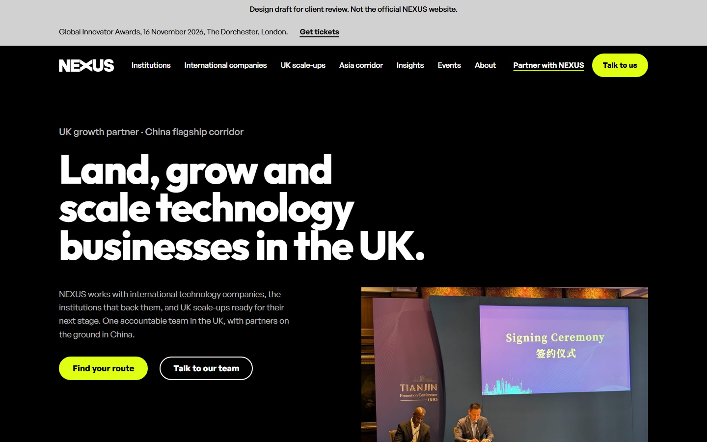
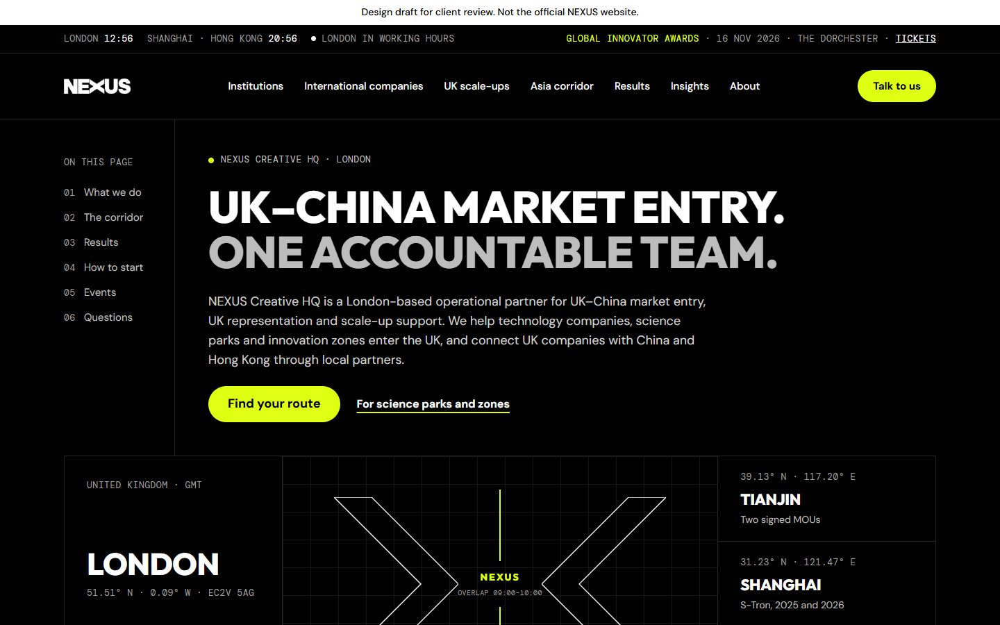
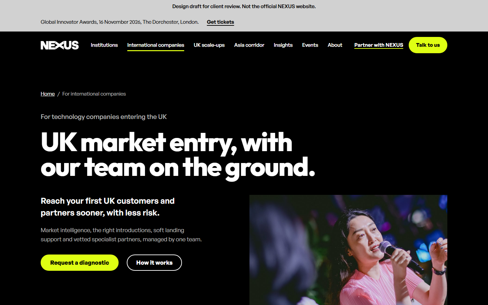
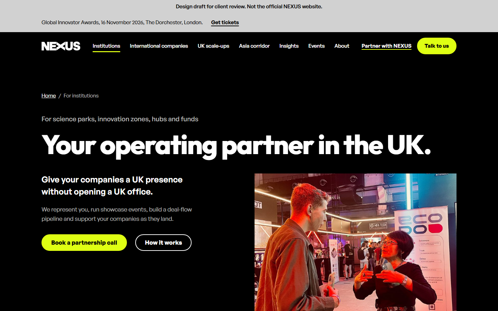
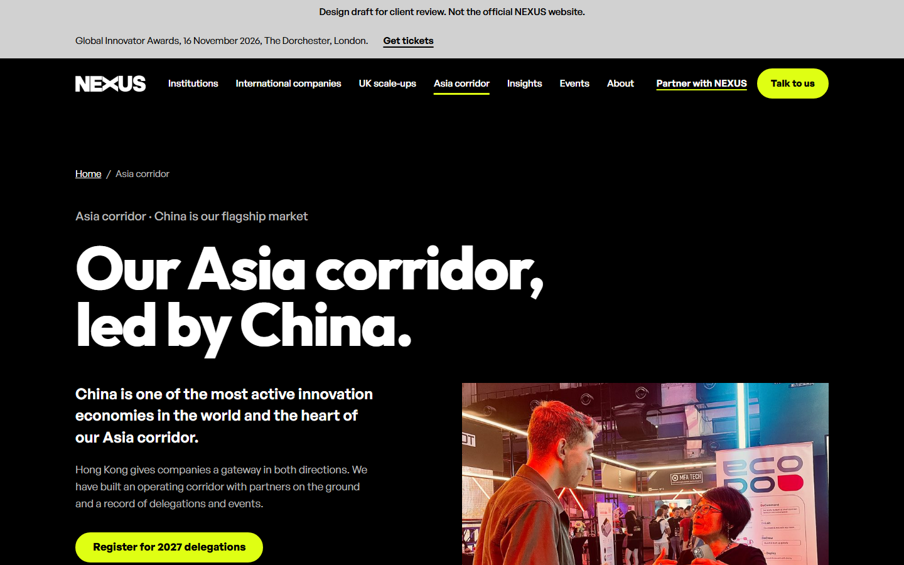

# NEXUS website, SEO and AI-search strategy

Research and planning for the rebuild of [nexuscreativehq.com](https://nexuscreativehq.com). NEXUS helps technology businesses land, grow and scale in the UK, with China as its flagship corridor. Launch target: Thursday 12 November 2026, before the Global Innovator Awards on Monday 16 November 2026.

## Start here

| Document | What it is |
|---|---|
| [`research/07-NEXUS-Mark-Facts.md`](research/07-NEXUS-Mark-Facts.md) | **Read first.** Mark's facts in one place: decisions, page specs, copy, proof, brand, forms, search and launch rules, what is still to confirm, and where our proposals differ |
| [`research/08-NEXUS-Decisions-For-Mark.md`](research/08-NEXUS-Decisions-For-Mark.md) | The 16 questions only Mark can answer before launch, each with the default we build meanwhile; ready to send |
| [`research/04-NEXUS-SEO-Guide.md`](research/04-NEXUS-SEO-Guide.md) | The main guide: the business explained, site audit, SEO/AEO/GEO strategy, each tool explained, playbooks, and NEXUS's other systems |
| [`research/02-NEXUS-Website-SEO-Strategy-Plan.md`](research/02-NEXUS-Website-SEO-Strategy-Plan.md) | Strategy plan: goals, positioning, audiences, keyword map, KPIs, timeline |
| [`research/01-NEXUS-Research-Findings.md`](research/01-NEXUS-Research-Findings.md) | Fact base, with each fact marked verified, client-stated, conflicting or missing |
| [`research/03-Client-Pack-What-To-Send.md`](research/03-Client-Pack-What-To-Send.md) | Message, questions and access list for the client |
| [`research/05-Claude-Design-Prompt-Pack.md`](research/05-Claude-Design-Prompt-Pack.md) | Prompts for designing pages and the deck in Claude Design |
| [`research/06-NEXUS-Landing-Page-Design-Plan.md`](research/06-NEXUS-Landing-Page-Design-Plan.md) | Which landing pages to design first in Claude Design, the design direction, considerations and business case |
| [`research/NEXUS-NotebookLM-Source.md`](research/NEXUS-NotebookLM-Source.md) | All four documents in one file, for NotebookLM |

Each document also has an `.html` copy styled in the NEXUS brand; download and open it in a browser, or print it to PDF.

## What else is here

- `NEXUS Website Brief Developer.docx`, `NEXUS Website Tool Guide.pdf`, `questions.txt`, `seo finding.txt`, `undersatding of seo resource.docx`, `seo lady draft.html`: the original client and team inputs.
- `NEXUS Brand Assets/`, `Partner Logos/` (and their `.zip` files): brand and partner logo files.
- `research/live-site/`, `research/olostep-pages/`, `research/raw/`: crawl of the current site and saved research answers.
- `research/local-docs/`: plain-text copies of the brief, case studies and prototype pages.
- `research/design-canvas/`: source of the Claude Design canvas (one `.dc.html` per artboard plus `canvas.json`). The current design is v3.1 (`Home31`, `International31`, `Institutions31`, `ScaleUps31`, `Asia31`): Mark's brief sections 4.2 to 4.4 and prototype copy in the brand look, generated by `build_v31.py`. `HomeV3` is the lean brand-led experiment before it; `HomeA`, `InternationalA`, `InstitutionsA` and `AsiaA` are the earlier A + B + index build; `Direction*` are the three explored directions and the rest is the first draft.
- `research/design-reviews/`: Codex and Gemini 4 Argon design and SEO critiques (two rounds) and screenshots of the directions and pages, including `v31-*.png` for the current design.
- `research/hasaan-wayne-site/`: code of Hasaan Wayne's brand build, the 24-page client-review copy (see below). Open `index.html` in a browser.
- `research/design-reviews/hasaan-wayne/`: screenshots of Hasaan Wayne's two website drafts (see below).

## Hasaan Wayne's designs

Two working website drafts, both live on GitHub Pages. Each is a client-review copy: hidden from search engines and labelled as a draft.

| Draft | What it is | Live site | Code |
|---|---|---|---|
| Brand build (current) | All 24 pages of the Phase 1 sitemap, rebuilt to Mark's brand guidelines and developer brief: Home, the three audience pages, Asia corridor, Partner with NEXUS, Events, Results and seven case-study pages, Insights, About, Endorsing role, Contact, Privacy, Cookies, Terms, Accessibility and 404. Real NEXUS photography from Mark's prototype, black-and-white team portraits, hover and focus motion only, cookie consent, nine enquiry forms and JSON-LD. The master build also has the sitemap and 175 old-URL redirects. In this public copy the case-study companies and the two partners awaiting approval are shown as placeholders | [hasaanwayne.github.io/nexus-website-draft](https://hasaanwayne.github.io/nexus-website-draft/) | [`research/hasaan-wayne-site/`](research/hasaan-wayne-site/) in this repo, and [Hasaanwayne/nexus-website-draft](https://github.com/Hasaanwayne/nexus-website-draft) |
| Draft one | The chosen design above (`HomeA`, `InternationalA`, `InstitutionsA`, `AsiaA`) built page for page as a working site: four pages, live corridor clocks, mobile menu, self-hosted fonts | [hasaanwayne.github.io/nexus-website-draft-one](https://hasaanwayne.github.io/nexus-website-draft-one/) | [Hasaanwayne/nexus-website-draft-one](https://github.com/Hasaanwayne/nexus-website-draft-one) |

The brand build replaces the earlier colour redesign at the same link.

Review against Mark's documents: [`research/design-reviews/hasaan-wayne/REVIEW.md`](research/design-reviews/hasaan-wayne/REVIEW.md) (written for the two earlier drafts).

**Addressed in the brand build:**
- Mark's Home H1, eyebrow, intro and buttons.
- Three audiences, the four statistics, and the brief's section order on every page.
- No paintings, no porcelain ground, and no scroll or load animation.
- Black, Electric Yellow, Studio Grey and white only, with yellow as an accent.
- Nav with seven items plus Partner with NEXUS and Talk to us, collapsing to Menu below 1100px.
- 1200px content width, 64 to 112px section spacing, and buttons at least 48px.
- Mark's titles and meta descriptions from brief section 10.
- Self-referencing canonicals in the master build. This review copy drops them.
- Anchors `#routes`, `#how`, `#start`, `#delegations`, `#about` and `#contact`.
- Footer columns, plus the Cookies and Accessibility pages.

**Still open:**
- Case-study companies and the two partners awaiting approval are named in the master build and hidden only in this public copy.
- Headlines use Outfit as a stand-in until the Neutral Face Bold web files arrive.
- Items marked `[to confirm]` wait on Mark's decisions in [`research/08-NEXUS-Decisions-For-Mark.md`](research/08-NEXUS-Decisions-For-Mark.md).

| Page | Brand build | Draft one |
|---|---|---|
| Home |  |  |
| International companies |  |  |
| Institutions |  |  |
| Asia corridor |  |  |

## Scripts (Python 3)

- `research/olostep.py`: Olostep API helper (`map`, `scrape`, `answer`). Reads `OLOSTEP_API_KEY` from your environment; no key is stored in this repo.
- `research/md_to_html.py <file.md>`: makes a branded HTML copy of a document.
- `research/build_notebooklm.py`: rebuilds the combined NotebookLM file.

Research compiled 31 October 2026. Partner names, logos, statistics and case studies are subject to NEXUS's approval before any public use on the website.
