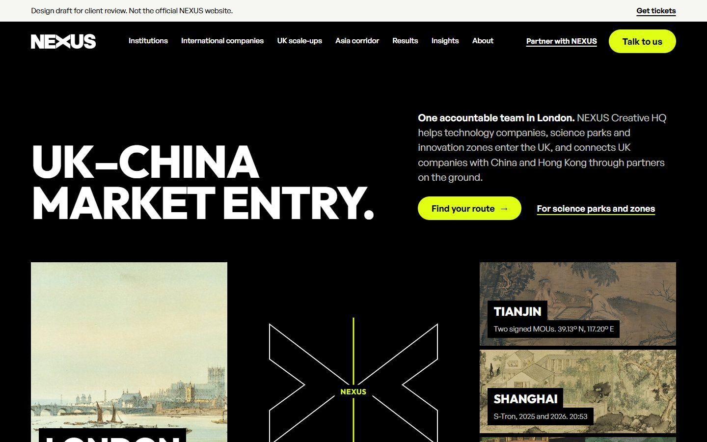
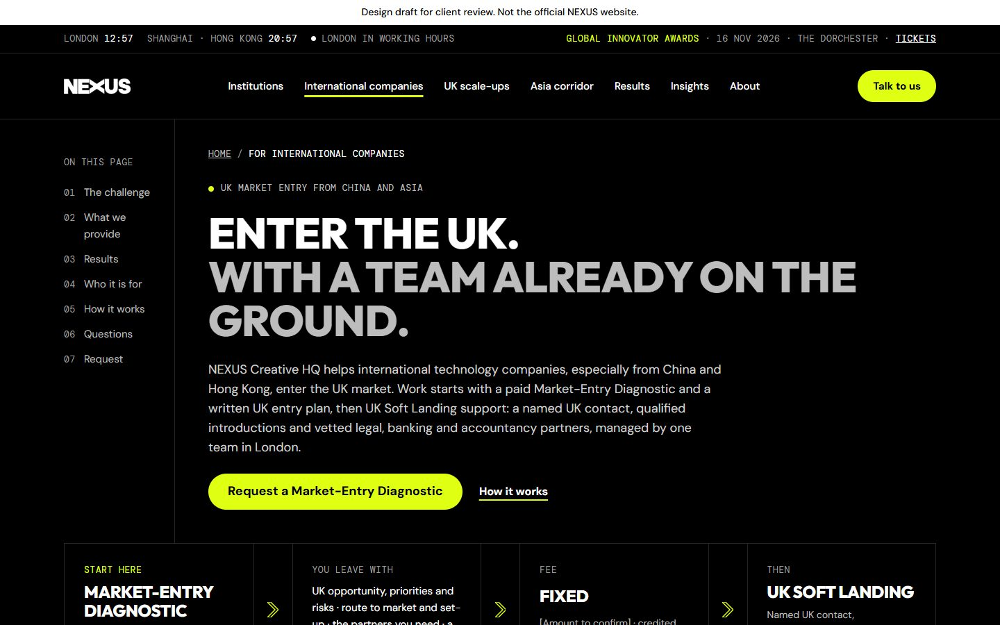
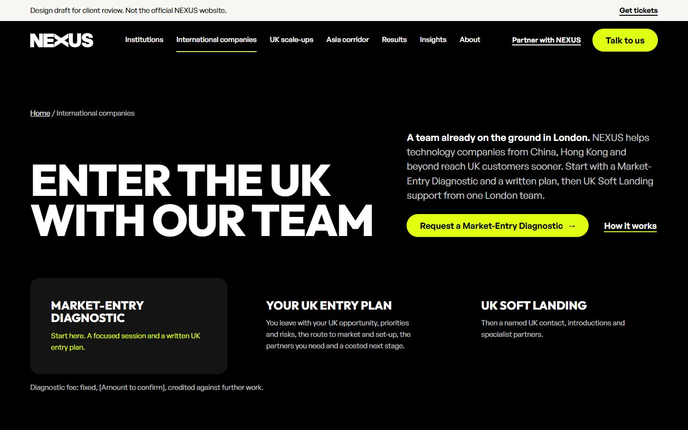
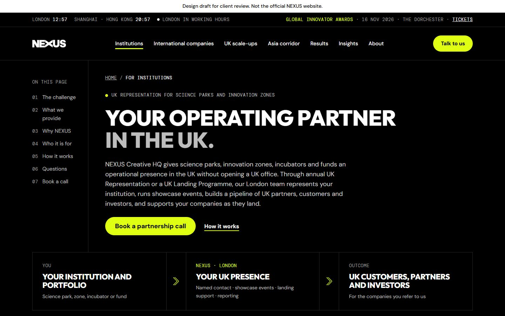
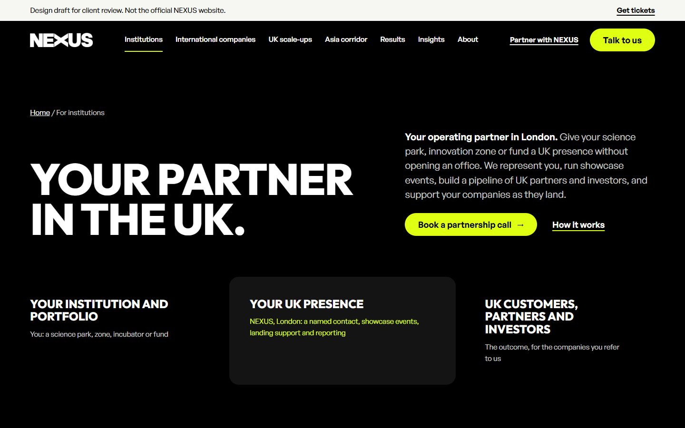
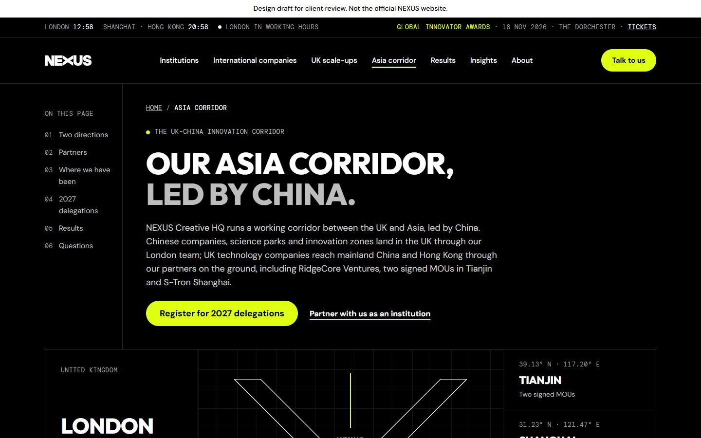
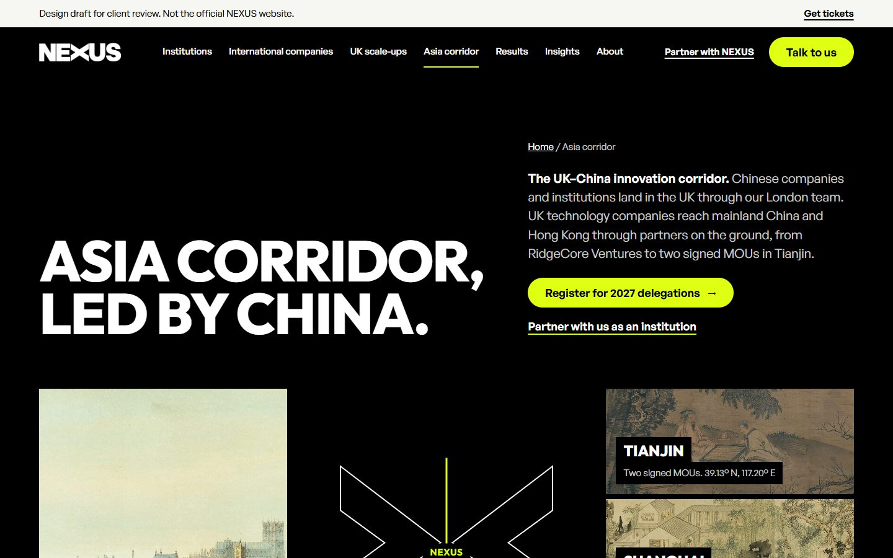

# NEXUS website, SEO and AI-search strategy

Research and planning for the rebuild of [nexuscreativehq.com](https://nexuscreativehq.com). NEXUS helps technology businesses land, grow and scale in the UK, with China as its flagship corridor. Launch target: Thursday 12 November 2026, before the Global Innovator Awards on Monday 16 November 2026.

## Start here

| Document | What it is |
|---|---|
| [`research/07-NEXUS-Mark-Facts.md`](research/07-NEXUS-Mark-Facts.md) | **Read first.** Mark's facts in one place: decisions, page specs, copy, proof, brand, forms, search and launch rules, what is still to confirm, and where our proposals differ |
| [`research/04-NEXUS-SEO-Guide.md`](research/04-NEXUS-SEO-Guide.md) | The main guide: the business explained, site audit, SEO/AEO/GEO strategy, each tool explained, playbooks, and NEXUS's other systems |
| [`research/02-NEXUS-Website-SEO-Strategy-Plan.md`](research/02-NEXUS-Website-SEO-Strategy-Plan.md) | Strategy plan: goals, positioning, audiences, keyword map, KPIs, timeline |
| [`research/01-NEXUS-Research-Findings.md`](research/01-NEXUS-Research-Findings.md) | Fact base, with each fact marked verified, client-stated, conflicting or missing |
| [`research/03-Client-Pack-What-To-Send.md`](research/03-Client-Pack-What-To-Send.md) | Message, questions and access list for the client |
| [`research/05-Claude-Design-Prompt-Pack.md`](research/05-Claude-Design-Prompt-Pack.md) | Prompts for designing pages and the deck in Claude Design |
| [`research/06-NEXUS-Landing-Page-Design-Plan.md`](research/06-NEXUS-Landing-Page-Design-Plan.md) | Which landing pages to design first in Claude Design, the design direction, considerations and business case |
| [`research/NEXUS-NotebookLM-Source.md`](research/NEXUS-NotebookLM-Source.md) | All four documents in one file, for NotebookLM |

Each document also has an `.html` copy styled in the NEXUS brand; download and open it in a browser, or print it to PDF.

## What else is here

- `NEXUS Website Brief Developer.docx`, `NEXUS Website Tool Guide.pdf`, `questions.txt`, `seo finding.txt`, `undersatding of seo resource.docx`, `seo lady draft.html`: the original client and team inputs.
- `NEXUS Brand Assets/`, `Partner Logos/` (and their `.zip` files): brand and partner logo files.
- `research/live-site/`, `research/olostep-pages/`, `research/raw/`: crawl of the current site and saved research answers.
- `research/local-docs/`: plain-text copies of the brief, case studies and prototype pages.
- `research/design-canvas/`: source of the Claude Design canvas (one `.dc.html` per artboard plus `canvas.json`). The current design is v3.1 (`Home31`, `International31`, `Institutions31`, `ScaleUps31`, `Asia31`): Mark's brief sections 4.2 to 4.4 and prototype copy in the brand look, generated by `build_v31.py`. `HomeV3` is the lean brand-led experiment before it; `HomeA`, `InternationalA`, `InstitutionsA` and `AsiaA` are the earlier A + B + index build; `Direction*` are the three explored directions and the rest is the first draft.
- `research/design-reviews/`: Codex and Gemini 4 Argon design and SEO critiques (two rounds) and screenshots of the directions and pages, including `v31-*.png` for the current design.
- `research/design-reviews/hasaan-wayne/`: screenshots of Hasaan Wayne's two website drafts (see below).

## Hasaan Wayne's designs

Two working website drafts of the same four pages (Home, International companies, Institutions, Asia corridor), both live on GitHub Pages. Each is a client-review copy: hidden from search engines, labelled as a draft, and with partner and client names awaiting approval shown as placeholders.

| Draft | What it is | Live site | Code |
|---|---|---|---|
| Draft one | The chosen design above (`HomeA`, `InternationalA`, `InstitutionsA`, `AsiaA`) built page for page as a working site: live corridor clocks, mobile menu, self-hosted fonts | [hasaanwayne.github.io/nexus-website-draft-one](https://hasaanwayne.github.io/nexus-website-draft-one/) | [Hasaanwayne/nexus-website-draft-one](https://github.com/Hasaanwayne/nexus-website-draft-one) |
| Colour redesign | The Crossing direction carried forward with public-domain paintings of London and China, a porcelain ground in place of Studio Grey, motion, and a single spacing system for sections, text and columns | [hasaanwayne.github.io/nexus-website-draft](https://hasaanwayne.github.io/nexus-website-draft/) | [Hasaanwayne/nexus-website-draft](https://github.com/Hasaanwayne/nexus-website-draft) |

Review against Mark's documents: [`research/design-reviews/hasaan-wayne/REVIEW.md`](research/design-reviews/hasaan-wayne/REVIEW.md) (what to fix first, and what to carry into the build).

| Page | Draft one | Colour redesign |
|---|---|---|
| Home |  |  |
| International companies |  |  |
| Institutions |  |  |
| Asia corridor |  |  |

## Scripts (Python 3)

- `research/olostep.py`: Olostep API helper (`map`, `scrape`, `answer`). Reads `OLOSTEP_API_KEY` from your environment; no key is stored in this repo.
- `research/md_to_html.py <file.md>`: makes a branded HTML copy of a document.
- `research/build_notebooklm.py`: rebuilds the combined NotebookLM file.

Research compiled 31 October 2026. Partner names, logos, statistics and case studies are subject to NEXUS's approval before any public use on the website.
