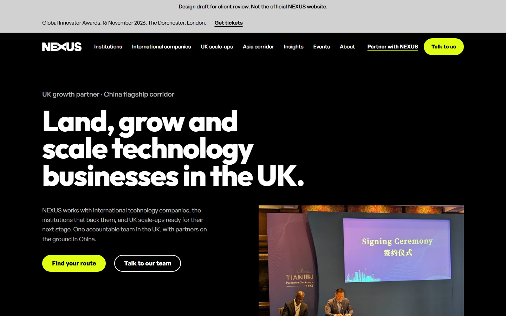
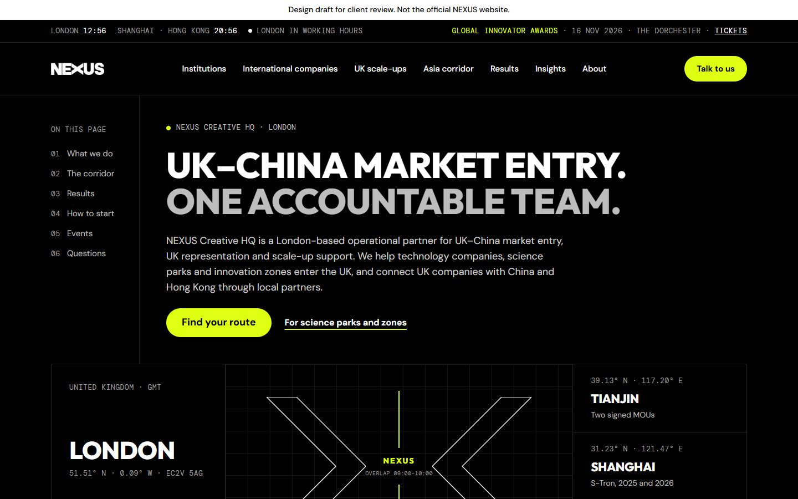
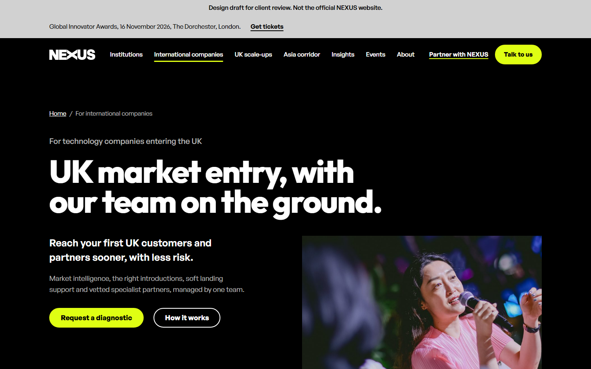
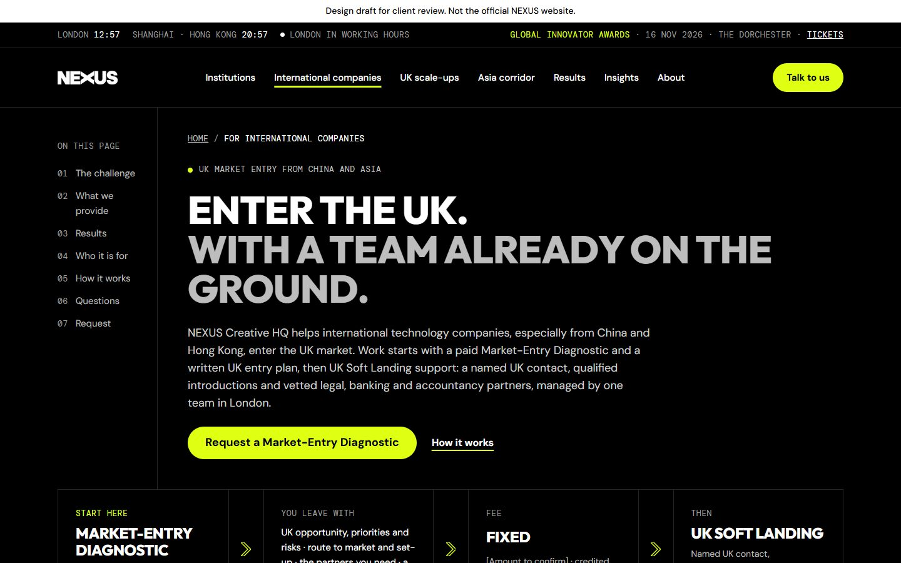
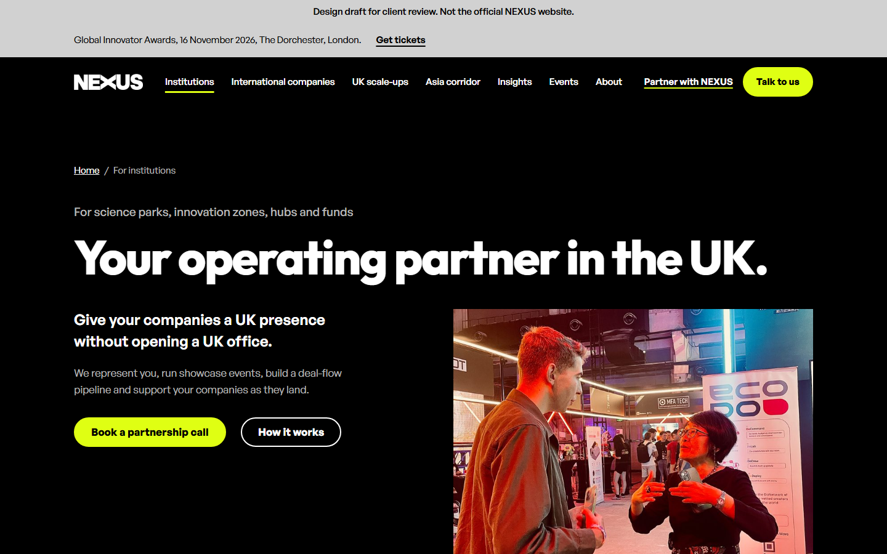
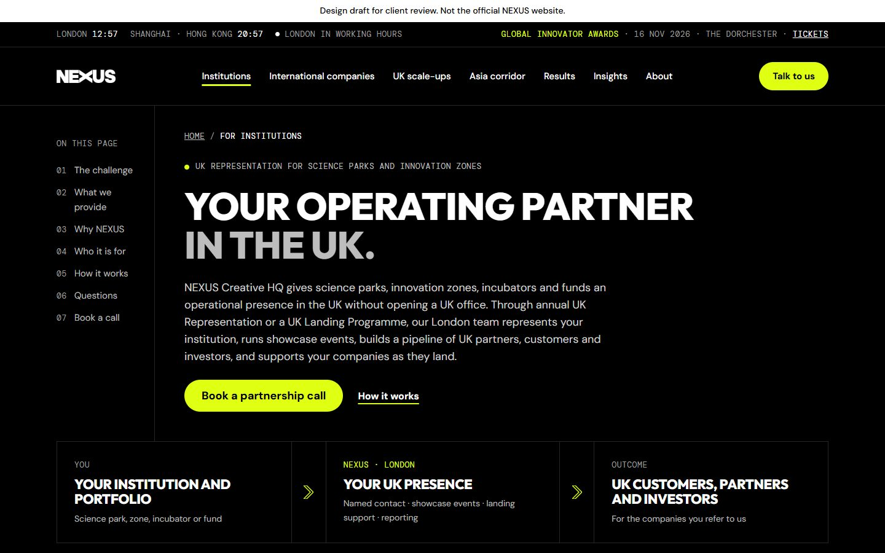
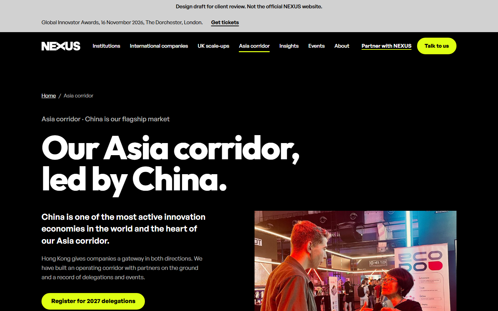
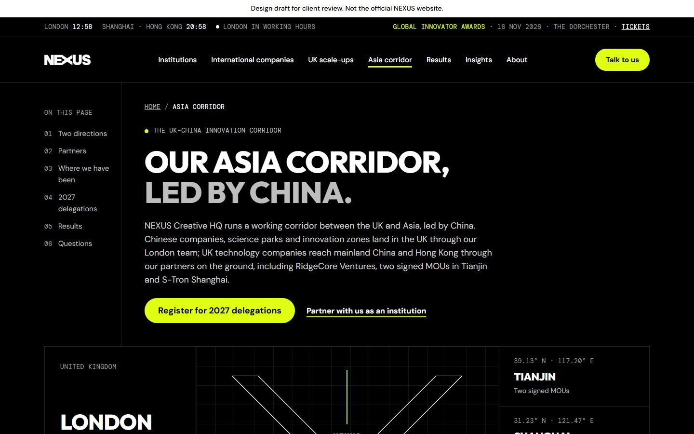

# Design

| Folder | What's in it |
|---|---|
| `hasaan-wayne-site/` | **The current build.** Code of Hasaan Wayne's 24-page brand build, the client-review copy. Open `index.html` in a browser |
| `canvas/` | Source of the Claude Design canvas: one `.dc.html` per artboard, plus `canvas.json` |
| `reviews/` | Codex and Gemini 4 Argon design and SEO critiques (two rounds), screenshots of every direction and page, and `hasaan-wayne/` (screenshots of Hasaan's builds plus our review) |

## Claude Design canvas

The canvas is at [claude.ai/artifact/AbQ6bpZJRg3w937oWy7jkY](https://claude.ai/artifact/AbQ6bpZJRg3w937oWy7jkY).

| Version | Artboards | What it is |
|---|---|---|
| v3.1 (current) | `Home31`, `International31`, `Institutions31`, `ScaleUps31`, `Asia31` | Mark's brief sections 4.2 to 4.4 and the prototype copy, in the brand look. Generated by `canvas/build_v31.py`. Screenshots: `reviews/v31-*.png` |
| v3 | `HomeV3` | The lean, brand-led experiment before v3.1 |
| A + B + index | `HomeA`, `InternationalA`, `InstitutionsA`, `AsiaA` | The earlier build. Screenshots: `reviews/final-*.png` |
| Directions | `DirectionA`, `DirectionB`, `DirectionC` | The three explored directions. Screenshots: `reviews/direction-*.png` |
| v1 | `Main`, `InternationalCompanies`, `Institutions`, `AsiaCorridor` | The first draft |

## Hasaan Wayne's designs

Two working website drafts, both live on GitHub Pages. Each is a client-review copy: hidden from search engines and labelled as a draft.

| Draft | What it is | Live site | Code |
|---|---|---|---|
| Brand build (current) | All 24 pages of the Phase 1 sitemap, rebuilt to Mark's brand guidelines and developer brief. See the page list below the table | [hasaanwayne.github.io/nexus-website-draft](https://hasaanwayne.github.io/nexus-website-draft/) | [`hasaan-wayne-site/`](hasaan-wayne-site/) in this repo, and [Hasaanwayne/nexus-website-draft](https://github.com/Hasaanwayne/nexus-website-draft) |
| Draft one | The A + B + index design (`HomeA`, `InternationalA`, `InstitutionsA`, `AsiaA`) built page for page as a working site: four pages, live corridor clocks, mobile menu, self-hosted fonts | [hasaanwayne.github.io/nexus-website-draft-one](https://hasaanwayne.github.io/nexus-website-draft-one/) | [Hasaanwayne/nexus-website-draft-one](https://github.com/Hasaanwayne/nexus-website-draft-one) |

**About the brand build:**
- **Pages:** Home, the three audience pages, Asia corridor, Partner with NEXUS, Events, Results and seven case-study pages, Insights, About, Endorsing role, Contact, Privacy, Cookies, Terms, Accessibility and 404.
- **Built in:** real NEXUS photography from Mark's prototype, black and white team portraits, motion on hover and focus only, cookie consent, nine enquiry forms and JSON-LD.
- **Master build only:** the sitemap and 175 old-URL redirects.
- **Public copy:** the case-study companies and the two partners awaiting approval appear as placeholders.
- It replaces the earlier colour redesign at the same link.

Our review against Mark's documents is [`reviews/hasaan-wayne/REVIEW.md`](reviews/hasaan-wayne/REVIEW.md). It was written for the two earlier drafts.

**Addressed in the brand build:**
- Mark's Home H1, eyebrow, intro and buttons.
- Three audiences, the four statistics, and the brief's section order on every page.
- No paintings, no porcelain ground, and no scroll or load animation.
- Black, Electric Yellow, Studio Grey and white only, with yellow as an accent.
- Nav with seven items plus Partner with NEXUS and Talk to us, collapsing to Menu below 1100px.
- 1200px content width, 64 to 112px section spacing, and buttons at least 48px.
- Mark's titles and meta descriptions from brief section 10.
- Self-referencing canonicals in the master build. This review copy drops them.
- Anchors `#routes`, `#how`, `#start`, `#delegations`, `#about` and `#contact`.
- Footer columns, plus the Cookies and Accessibility pages.

**Still open:**
- Case-study companies and the two partners awaiting approval are named in the master build and hidden only in this public copy.
- Headlines use Outfit as a stand-in until the Neutral Face Bold web files arrive.
- Items marked `[to confirm]` wait on Mark's answers to the questions in our 5 November proposal (section 11).

| Page | Brand build | Draft one |
|---|---|---|
| Home |  |  |
| International companies |  |  |
| Institutions |  |  |
| Asia corridor |  |  |
